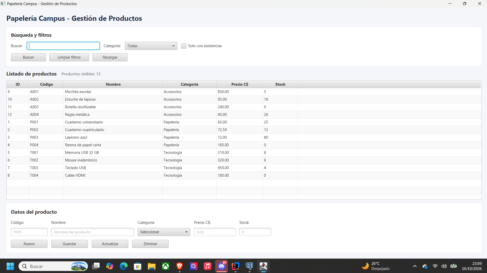
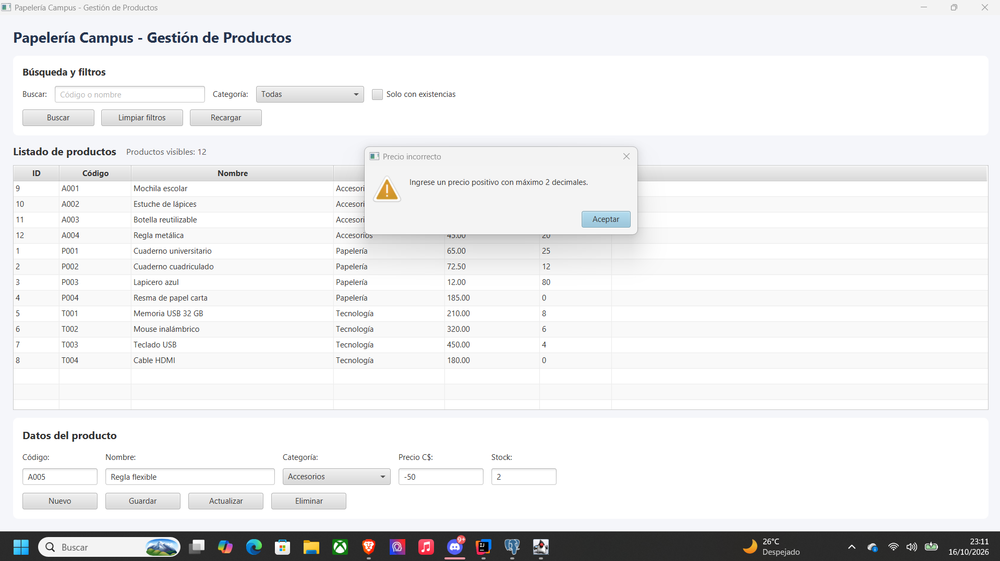
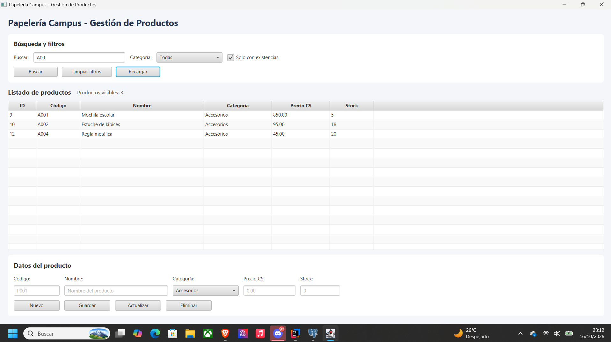

# PRUEBAS Y EVIDENCIAS — PAPELERÍA CAMPUS

**Estudiante:** Zahid Benjamín Reyes López  
**Asignatura:** Programación de Aplicaciones de Escritorio  
**Fecha:** 16/10/2026  
**Tecnologías:** Java 21, JavaFX, JDBC y PostgreSQL 18

---

## 1. Objetivo

Comprobar el correcto funcionamiento de la aplicación Papelería Campus mediante pruebas de visualización de datos, búsquedas con parámetros, operaciones CRUD, validaciones y manejo de errores.

Las pruebas se realizaron utilizando la interfaz gráfica de JavaFX y la base de datos PostgreSQL.

---

## 2. Evidencias de funcionamiento

### Evidencia 1. Validación del formulario

Se comprobó que la aplicación reconoce datos inválidos e impide registrar información incorrecta, mostrando un mensaje de advertencia al usuario.

**Resultado: APROBADO**

---

### Evidencia 2. Visualización de productos en TableView

Se comprobó que los productos registrados en PostgreSQL se cargan correctamente en el TableView.

La tabla muestra los campos ID, código, nombre, categoría, precio y stock, además del contador de registros.

**Resultado: APROBADO**

---

### Evidencia 3. Búsqueda mediante parámetros

Se verificó que la aplicación permite realizar consultas utilizando filtros por texto, categoría y disponibilidad de existencias.

Los resultados se muestran en el TableView según los parámetros seleccionados.

**Resultado: APROBADO**

---

## 3. Pruebas de búsquedas y filtros (B1–B7)

| Prueba | Datos ingresados | Resultado esperado | Resultado obtenido | Estado |
|---|---|---|---|---|
| B1 | Buscar CUADERNO | P001 y P002 | 2 productos encontrados | APROBADO |
| B2 | Buscar T00 | T001, T002, T003 y T004 | 4 productos encontrados | APROBADO |
| B3 | Seleccionar Papelería | P001, P002, P003 y P004 | 4 productos encontrados | APROBADO |
| B4 | Activar Solo con existencias | Productos con stock mayor a 0 | 9 productos encontrados | APROBADO |
| B5 | USB + Tecnología + Solo con existencias | T001 y T003 | 2 productos encontrados | APROBADO |
| B6 | Buscar ZZZ999 | Ningún producto y aviso informativo | 0 productos encontrados | APROBADO |
| B7 | Presionar Limpiar filtros | Restaurar los 12 productos iniciales | 12 productos mostrados | APROBADO |

**Resultado general:** 7 de 7 pruebas aprobadas.

---

## 4. Pruebas de operaciones CRUD

Para comprobar las operaciones CRUD se utilizó un producto temporal con los siguientes datos:

- **Código:** X001
- **Nombre:** Producto de prueba
- **Categoría:** Accesorios
- **Precio:** 10.00
- **Stock:** 1

### 4.1 Registro de productos

Se ingresaron los datos en el formulario y se presionó el botón Guardar.

**Resultado esperado:** El producto se registra en PostgreSQL y el contador aumenta de 12 a 13.

**Resultado obtenido:** El producto se agregó correctamente.

**Estado: APROBADO**

### 4.2 Actualización de productos

Se seleccionó el producto X001 en el TableView y se modificaron los siguientes valores:

- **Precio:** 15.50
- **Stock:** 3

Después se presionó el botón Actualizar.

**Resultado esperado:** Los cambios se guardan y se mantiene el total de 13 registros.

**Resultado obtenido:** Los datos del producto se actualizaron correctamente.

**Estado: APROBADO**

### 4.3 Cancelación de eliminación

Se seleccionó el producto X001, se presionó Eliminar y se canceló el mensaje de confirmación.

**Resultado esperado:** El producto permanece registrado.

**Resultado obtenido:** El producto no fue eliminado.

**Estado: APROBADO**

### 4.4 Eliminación de productos

Se seleccionó nuevamente X001 y se confirmó su eliminación.

**Resultado esperado:** El producto desaparece de PostgreSQL y el total regresa a 12 registros.

**Resultado obtenido:** El producto fue eliminado correctamente.

**Estado: APROBADO**

### 4.5 Persistencia de datos

Se verificó que la información mostrada en el TableView corresponde a los registros almacenados en PostgreSQL después de recargar la aplicación.

**Estado: APROBADO**

**Resultado general del ciclo CRUD:** 4 de 4 operaciones aprobadas.

---

## 5. Pruebas de validaciones (V1–V10)

| Prueba | Datos evaluados | Resultado esperado | Resultado obtenido | Estado |
|---|---|---|---|---|
| V1 | Código vacío, espacios o más de 10 caracteres | Rechazar código inválido | Datos rechazados | APROBADO |
| V2 | Nombre vacío, menor de 3 o mayor de 80 caracteres | Rechazar nombre inválido | Datos rechazados | APROBADO |
| V3 | Categoría sin seleccionar o no permitida | Rechazar categoría inválida | Validación correcta | APROBADO |
| V4 | Precio con letras, por ejemplo abc | Rechazar valores no numéricos | Dato rechazado | APROBADO |
| V5 | Precio igual a 0 o negativo | Rechazar precio | Datos rechazados | APROBADO |
| V6 | Precio con más de 2 decimales o fuera del límite | Rechazar precio inválido | Datos rechazados | APROBADO |
| V7 | Stock con letras o decimales | Rechazar valores no enteros | Datos rechazados | APROBADO |
| V8 | Stock negativo, fuera del rango y stock igual a 0 | Rechazar valores inválidos y permitir 0 | Validación correcta | APROBADO |
| V9 | Código duplicado con espacios o minúsculas | Rechazar duplicados | Validación correcta | APROBADO |
| V10 | Actualizar o eliminar sin seleccionar producto | Mostrar advertencia | Advertencia mostrada | APROBADO |

**Resultado general:** 10 de 10 pruebas aprobadas.

---

## 6. Pruebas de manejo de errores (E1–E4)

| Prueba | Comprobación | Resultado esperado | Resultado obtenido | Estado |
|---|---|---|---|---|
| E1 | Fallo de conexión con PostgreSQL | Controlar el error y mostrar advertencia | Error controlado | APROBADO |
| E2 | Incumplimiento de restricciones UNIQUE o CHECK | Rechazar operación mediante PostgreSQL | Restricción aplicada correctamente | APROBADO |
| E3 | Actualización o eliminación sin filas afectadas | No informar una operación exitosa | Operación controlada | APROBADO |
| E4 | Registro de errores SQL | Registrar operación y SQLState sin mostrar credenciales | Manejo correcto | APROBADO |

**Resultado general:** 4 de 4 pruebas aprobadas.

---

## 7. Resumen de resultados

| Grupo de pruebas | Realizadas | Aprobadas |
|---|---:|---:|
| Búsquedas y filtros | 7 | 7 |
| Operaciones CRUD | 4 | 4 |
| Validaciones | 10 | 10 |
| Manejo de errores | 4 | 4 |
| **TOTAL** | **25** | **25** |

**Resultado final: 25 de 25 pruebas aprobadas (100 %).**

---

## 8. Conclusión

Las pruebas realizadas permitieron comprobar el funcionamiento de la aplicación Papelería Campus.

Se verificó la carga de productos desde PostgreSQL hacia el TableView, el funcionamiento de las búsquedas con parámetros, las operaciones CRUD, las validaciones del formulario y el manejo de errores.

Los resultados obtenidos fueron satisfactorios, cumpliendo con las funcionalidades establecidas para el laboratorio.

Las tres evidencias gráficas incluidas respaldan la validación del formulario, la visualización de productos y las consultas con filtros.

El funcionamiento del CRUD también será revisado directamente por el docente durante la evaluación de la aplicación.